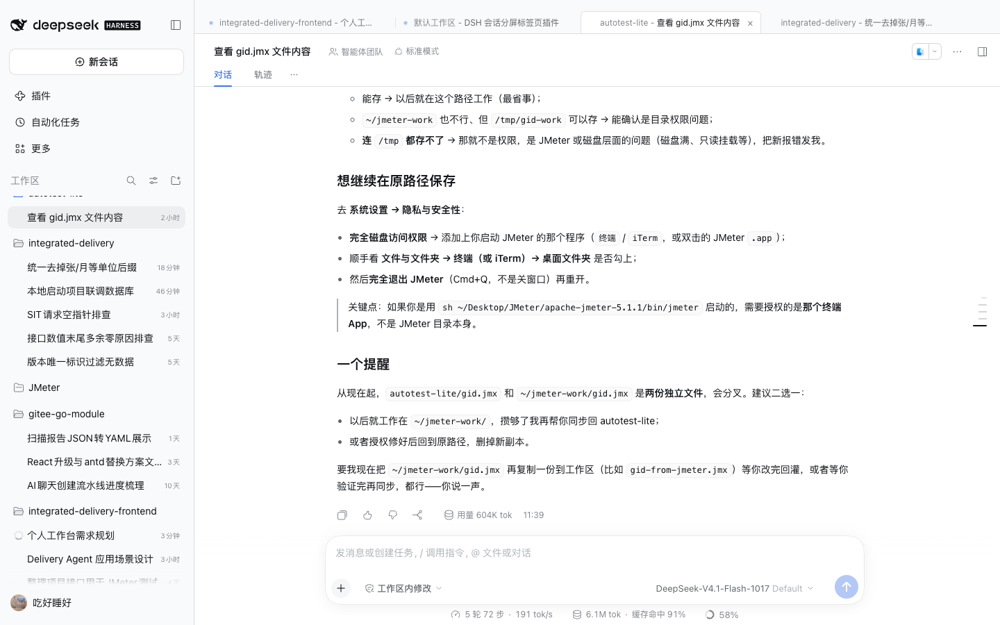
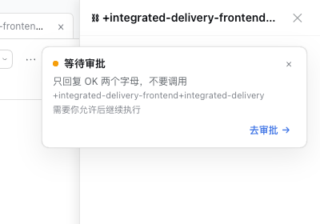
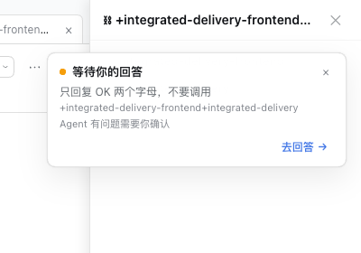
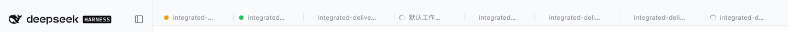
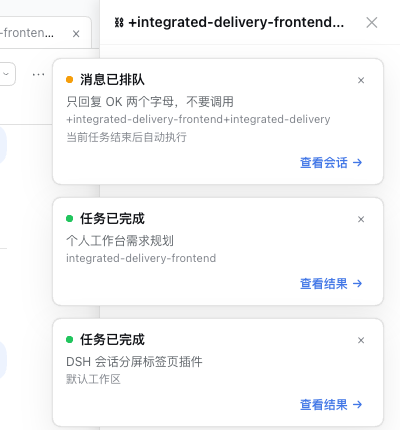
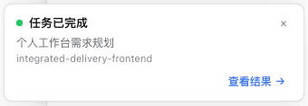
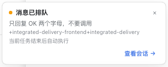
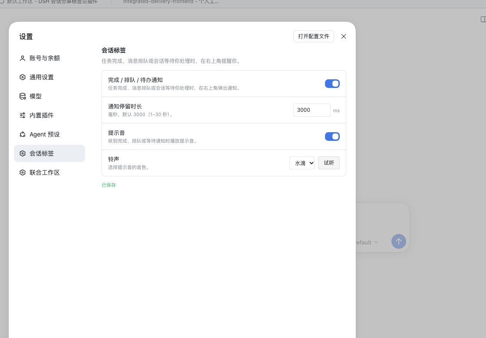

# dsh-session-tabs · DSH 会话标签栏

为 DSH Web GUI 提供 Chrome 风格的**会话标签栏**：点左侧任意会话就把它钉到中间内容区顶部，标签标题为 `工作区名称 - 任务名`，并用状态图标告诉你哪个会话正在执行、哪个在等待你、哪个已经完成；任务完成、消息排队或会话等待你处理时，右上角会弹出可一键跳转的通知。

> 只做标签栏，不做真正的左右并排。切换标签等价于切换主视图的当前会话。



## 功能

- **点会话即加标签**：点击左侧会话列表中的任意会话（或从搜索打开、fork 出的会话）都会自动出现在标签栏；直接导航到某个会话（例如从搜索跳转）也会补上标签。
- **Chrome 风格**：标签栏底色 = DSH 左侧栏底色，激活标签 = 内容区底色（浅色是白色），标签之间是短的竖向分隔线（不是标签自身的右边框，最后一个标签右侧没有线），激活/悬停标签两侧的分隔线自动隐藏，激活标签与下方内容无缝相接；悬停才显示关闭 ×。
- **`工作区名称 - 任务名`**：工作区名取自会话所属 Workspace 的标题（默认工作区会显示为「默认工作区」），任务名取自会话标题；标题变化会实时更新。
- **状态**：
  - DSH 同款转圈 spinner = **执行中**（会话正在跑；按 DSH 的 1.5s 轨道 + 弧线动画绘制）
  - 黄色圆点 = **等待**：消息排队、等待审批、等待你的回答或计划待确认；hover 的 tooltip 会区分具体原因（`--dsw-alias-state-warn-primary`）
  - 绿色圆点 = **已完成**（会话在你没有看它的时候结束；10px 容器 / 8px 圆点（`border-radius: 999px`），颜色 `--dsw-alias-state-success-primary`）
  - 无标记 = 空闲
  - 打开该标签后，DSH 会确认完成状态，绿点自动消失。
  - 正在执行时即使还有排队消息也显示 spinner，因为当前 turn 正在跑。
- **右上角通知**：标签对应的会话在后台完成、运行中又收到一条排队消息，或暂停等待你处理（审批 / 回答 / 计划确认）时，右上角弹出通知卡片。卡片按类型显示「任务已完成」「消息已排队」「等待审批」「等待你的回答」「计划待确认」，并写明「当前任务结束后自动执行」「需要你允许后继续执行」「Agent 有问题需要你确认」「计划已提交，等待你批准」；按钮分别为「查看结果 / 查看会话 / 去审批 / 去回答 / 查看计划」。卡片显示任务名与工作区名，右下角的按钮可直接跳到对应标签/表单。新通知以 420ms 缓动从上往下滑入，并按时间顺序向下堆叠；每条占独立位置，进入动画过程中也不重叠；完成通知对正在看的标签不弹，排队/待办通知不受此限制；同一会话只会保留一张，最多同时 3 张。
  - 通知默认开启、停留 **3000ms**，可在 **设置 → 会话标签** 里关闭或改成 1000–30000ms。
  - **提示音**默认关闭；开启后可选「清脆 / 柔和 / 木琴 / 水滴」四种音色，并点「试听」立即播放。提示音由 Web Audio 合成，不依赖外部音频文件；只对完成 / 排队 / 待办通知播放，700ms 内的连续通知只响一次，避免叠音。
  - 插件本身不内嵌铃声；如果关闭提示音后仍听到声音，那是系统通知或其他插件的提示音，需要单独关闭。
  - 点击按钮会激活标签并打开该会话；点 × 或等超时自动消失。








- **后台继续运行**：标签只是导航入口，不会 retain / 打开 / 销毁会话。DSH 本身会让后台会话继续跑，全局状态流负责更新圆点和对勾。
- **持久化**：标签顺序与最后激活的标签同时写入主进程的 `~/.dsh/session-tabs.json` 和浏览器 `localStorage`。桌面版每次启动的本地端口会变化（页面 origin 随之变化），所以以主进程文件为准——**重启 DSH 后标签仍会恢复**。
- **关闭**：× 按钮或鼠标中键；关闭当前标签会切到相邻标签。关闭标签不会关闭会话。
- **拖拽排序**：按住任意标签左右拖动，松手即交换位置；顺序会同步到主进程和 localStorage。
- **窗口拖动区**：标签上方留出 14px 空白（含标签行内边距共 16px，不超过 24px），标签行右侧的空白也同样生效，按住即可拖动整个 DSH 桌面窗口；标签本身是 `no-drag`，不会误拖窗口。
- **溢出滚动**：标签过多时横向滚动，也支持鼠标滚轮横向滚动。
- **空态**：没有标签时标签栏高度为 0，完全不占空间。
- **新会话延迟入栏**：空白「新会话」不会立刻占一个标签；发出第一条消息、有了任务名之后才出现。

## 安装

包内有 `dsh.client` 声明与 `cordis.patch.yml`（bundle patch）。普通 profile 可直接：

```bash
dsh plugin --profile <profile> add link:/Users/zhanglankai/Documents/deepseek-harness/default-workspace/dsh-session-tabs
```

**桌面版例外**：`desktop` profile 由 Electron 应用独占管理，CLI 会报
`profile "desktop" is managed exclusively by the Electron application`。手工安装两步即可：

```bash
PLUGIN=/Users/zhanglankai/Documents/deepseek-harness/default-workspace/dsh-session-tabs
PROFILE=$HOME/.dsh/profiles/desktop

# 1) 让 profile 能解析包名
ln -s "$PLUGIN" "$PROFILE/node_modules/dsh-session-tabs"

# 2) 在 $PROFILE/cordis.patch.yml 末尾追加
# - insert:
#     - id: session-tabs
#       name: 'dsh-session-tabs'
```

DSH 默认开启 HMR：追加这一行后插件会尝试热加载；主进程半个插件（新增的存储路由）如果没生效，重启一次 DSH 即可。之后升级本插件只改 `lib/` 文件，客户端会热重载。

### 卸载

```bash
rm "$PROFILE/node_modules/dsh-session-tabs"          # 软链
# 从 $PROFILE/cordis.patch.yml 删除 session-tabs 的 insert 行
rm -f "$HOME/.dsh/session-tabs.json"                  # 可选：清掉持久化标签
rm -f "$HOME/.dsh/session-tabs-prefs.json"             # 可选：清掉通知设置
```

## 使用

1. 在左侧点一个会话 —— 它立刻出现在顶部标签栏。
2. 再点另一个会话 —— 第二个标签出现，第一个转到后台继续跑。
3. 看标签上的圆点/对勾判断状态，点标签切回去。
4. 刷新页面或重启 DSH，标签还在。
5. 鼠标中键或 × 关闭标签。
6. 后台任务完成或开始等待时，留意右上角通知；点「查看结果 / 打开标签」跳回去。
7. 不想被打扰就到 **设置 → 会话标签** 关闭通知/提示音，或调整停留时长。

## 实现说明

- 客户端 bundle 是手写的 `window.__ModuleLoader__.load({ id, factory })` 模块（与 DSH 自带客户端插件同格式），**无需构建步骤**。
- 挂载点：布局帧的中间列（`[data-rightbar-col]` 的前一个兄弟节点）。标签栏作为该列的第一个 flex 子元素，自然占据高度，不会盖住会话标题栏；侧栏折叠时用 `--dsh-frame-leading-clearance` 给 macOS 红绿灯留位。
- 数据来源：
  - `ctx.sessions.list` —— 会话列表、标题、`cwd`、`blank`、`retainedBy.mainView`（判断当前主视图会话）。
  - `ctx.workspaces.list` —— Workspace 标题（`sessionIds` 归属，其次 `path === cwd`）。
  - `ctx.uiSession.sessionStatus` —— `running` / `completionUnread`。
  - `ctx.sessions.list` 快照里的 `projectionsBySession[id].values.inbox` —— `next-turn` / `next-step` 队列行数，用来判断「等待执行」。
  - `ctx.uiWorkspace.openSession(id)` + `ctx.layout.selectPanel(null)` —— 切换标签。
- 通知判定：
  - **完成**：比较前后两次 `statusOf`，`running → done`（`completionUnread`）时弹；正在看的标签不弹。
  - **等待你处理**：`pendingInteraction` 从无到有或 kind 变化时立即弹，正在看的标签也弹；按 `kind` 分流：`approval` →「等待审批/去审批」，`question` →「等待你的回答/去回答」，`plan-review` →「计划待确认/查看计划」，未知 kind →「等待你处理/查看会话」。`pendingInteraction` 清空（允许、拒绝、回答、超时）时撤掉。注意它在状态上**优先于 running**：turn 虽然还在，但已经停住等你决定。
  - **消息排队**：只有「会话已经在 running，又新增了一条排队消息」才提醒。判断依据是 `inbox` 投影里 `next-turn + next-step` 行数增加 + 前一帧状态为 running；新问题正常提交时 inbox 也会短暂出现一行、会话随后才变 running，这种情况**不弹**。队列行数增加后还会等 1.2 秒，确认仍在排队才弹；如果这条消息在等待期间已经被 Host 自动执行、队列归零，则通知不出现（已出现的也会立即撤掉），避免出现「点了却找不到待执行消息」。
  - 排队通知显示期间队列被 Host 自动消费（开始执行）时会立即撤掉；标签关闭、关闭通知、或同一会话换成新通知时也会移除。首帧不补弹历史状态，避免刷新时刷屏。
- 侧栏点击通过 `data-row-key="session:<id>"` 的行点击事件捕获；文档级点击监听保证「已经是当前会话」时也能补回标签。
- 窗口拖动：标签上方的空白条与标签行都带 `data-window-drag`（ui-web 的 darwin 基础样式会把该标记变成 `-webkit-app-region: drag`），插件 CSS 同时直接声明 `app-region: drag` 以覆盖 Windows；标签自身声明 `no-drag`。
- 拖拽重排：拖动时把源标签切成实底（`[data-dragging]`），并用 **canvas 现画一张不透明拖影**（背景 `--dsw-alias-bg-base`、边框 `--dsw-alias-border-l3`、标题截断）作为 `setDragImage`，避免非激活标签透明背景导致拖影文字与其它标签重叠；落点用 `::before` 竖线提示。
- 主进程半个插件做两件事：
  - `GET/POST /api/dsh-session-tabs/state` 读写 `~/.dsh/session-tabs.json`（仅回环地址、原子写入、最多 50 个标签），解决「桌面版端口每次启动都变 → localStorage 换 origin」的问题。
  - `GET/POST /api/dsh-session-tabs/prefs` 读写 `~/.dsh/session-tabs-prefs.json`（`{ enabled, durationMs, sound, tone }`，时长夹在 1000–30000ms），供「设置 → 会话标签」和通知逻辑共用；客户端同时用 localStorage 兜底，断网/旧主进程也能工作。
- 所有全局副作用都注册在 `ctx.effect` 内；卸载时移除 DOM、样式、事件监听与 MutationObserver，HMR 重新 apply 时会先清理旧实例，避免标签栏重复。

## 主题与暗色模式

DSH 自带 `light / dark / system` 三档主题（设置 → 通用 → 外观），暗色调色板由 `body[data-ds-dark-theme]` 切换。本插件**只使用 DSH 的语义 token**，不写死颜色，因此自动跟随主题：

| 用途 | Token |
| --- | --- |
| 标签栏底色（框架） | `--dsw-specific-sidebar-fill`（浅色 `#f9fafb` / 深色 `#1b1b1c`） |
| 激活标签背景 | `--dsw-alias-bg-base`（浅色 `#fff` / 深色 `#151517`，即内容区底色） |
| 悬停背景 | `--dsw-alias-interactive-bg-hover` |
| 文字（主/次/弱） | `--dsw-alias-label-primary`、`--dsw-alias-label-secondary`、`--dsw-alias-label-tertiary` |
| 边框 / 标签分隔线 | `--dsw-alias-border-l3`、`color-mix(in srgb, var(--dsw-alias-label-primary) 9%, transparent)` |
| 执行中 | `--dsw-alias-state-business-primary` |
| 完成 | `--dsw-alias-state-success-primary` |
| 拖拽中抬起的标签 | `--dsw-shadow-lv2` |

这些 token 定义在 `@deepseek-ai/dsh-client-ui-theme` 的样式表里（`--dsw-*` 是唯一颜色权威）；第三方主题可以通过 `ctx.theme` 注册 alias 覆盖，标签栏会跟着变。实测 light → dark：背景 `#fff → #151517`、主文字 `#0f1115 → #f9fafb`、边框 `rgb(0 0 0 / 12%) → rgb(255 255 255 / 16%)`。

## 已知限制

- 只支持 Web GUI（`dsh.client.platform: "web"`）。
- 不支持真正的左右并排两个会话（DSH 主面板同一时间只绑定一个会话）。
- 关闭全部标签不会关闭会话，只表示「不再盯着它」；会话仍在左侧列表里。
- 「等待执行」依赖该会话已加载的 `inbox` 投影：在本 GUI 打开（或曾有控制流）的会话才可见；从未在本客户端打开过的后台会话可能暂时读不到队列。只统计 Host 已接收的队列行，不包含本地尚未发送完成的 echo。
- 拖拽排序使用 HTML5 drag & drop，暂不支持拖到其他窗口。
- 联合工作区（dsh-union-workspace）自动生成的标题形如 `+a+b`，标签会照实显示，可能较长（标签最大宽度 280px，超出省略）。
- 通知只针对当前标签栏里的会话；没开标签的会话不弹。通知设置是主进程文件级的，同一台机器上的所有 GUI 页面共享。
- 对已被归档/释放、无法再 `openSession` 的会话，通知按钮仍会把它设为当前标签，但主视图可能打不开并显示 DSH 自己的错误提示。

## 开发与排查

- 直接编辑 `lib/client.js` / `lib/index.js`，保存后 DSH 的 HMR 会重载对应半边。
- 浏览器控制台过滤 `[session-tabs]`。
- 本地缓存：`localStorage.getItem("dsh-session-tabs/v1")`、`localStorage.getItem("dsh-session-tabs/prefs/v1")`。
- 主进程文件：`~/.dsh/session-tabs.json`、`~/.dsh/session-tabs-prefs.json`。
- 路由自检（在 GUI 页面控制台）：`await (await fetch('/api/dsh-session-tabs/state')).json()`、`await (await fetch('/api/dsh-session-tabs/prefs')).json()`。
