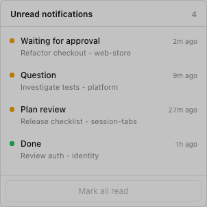

# DSH 会话标签栏

[English](README.md) | 中文

[](https://www.npmjs.com/package/@hazlank/dsh-session-tabs)
[](LICENSE)
[](https://github.com/Hazlank/dsh-session-tabs/actions/workflows/ci.yml)
[](https://github.com/deepseek-ai/deepseek-harness)

为 DSH Web GUI 提供 Chrome 风格的**会话标签栏**。点击左侧任意会话，它会被钉到中间内容区顶部，显示任务名、工作区和实时状态；后台任务完成或等待你处理时，右上角会弹出通知，标签栏最左侧的铃铛按会话保留未读条目。刷新页面或重启应用后，标签仍会恢复。


> 社区插件，与 DeepSeek 官方无隶属关系，也不代表官方背书。标签只是快捷入口：关闭标签不会关闭或归档对应会话。

## 为什么需要它

DSH 主面板同一时间只绑定一个会话。左侧列表适合找会话，但不适合同时盯着几个后台任务。这个插件在会话区上方加一条很窄的标签栏，复用 DSH 自己的状态流，回答三个问题：

- 哪些会话还在执行？
- 哪个会话在等审批、等回答或等确认计划？
- 我在看别的会话时，哪些任务已经完成？

它**不做**真正的左右并排；切换标签等价于切换主视图的当前会话。

## 安装

### 桌面版

打开 **设置 → 插件 → Add plugin**，输入 `@hazlank/dsh-session-tabs` 并安装。启用插件后，如果主进程半边尚未加载，刷新一次窗口即可。

### Web profile

```sh
dsh plugin --profile web add @hazlank/dsh-session-tabs
```

profile 名称按你的环境替换 `web`。包内同时包含宿主半边和浏览器半边，安装后由 `cordis.patch.yml` 自动挂载。

### 从 GitHub 安装

```sh
dsh plugin --profile web add github:Hazlank/dsh-session-tabs
```

### 本地开发安装

仅用于开发调试：

```sh
dsh plugin --profile web add link:/绝对路径/dsh-session-tabs
```

## 功能

### 标签

- **点会话即入栏**：从左侧列表、搜索或 fork 打开会话都会加标签；直接导航到某个会话也会补上。
- **任务名 - 工作区名**：任务名取自会话标题，工作区名取自所属 Workspace 的标题；默认工作区显示为「默认工作区」，标题变化会实时更新。
- **Chrome 风格表面**：标签栏底色跟随左侧栏；激活标签使用内容区底色，并与下方内容无缝相接；标签之间是短分隔线，激活或悬停时两侧分隔线隐藏；关闭 `×` 只在悬停时出现。
- **拖拽排序**：拖到标签之间即可调整顺序，顺序会持久化。
- **溢出滚动**：标签过多时横向滚动，也支持鼠标滚轮横向滚动。
- **安全关闭**：点 `×` 或鼠标中键关闭标签；关闭当前标签会切到相邻标签；DSH 会话本身不受影响。
- **空白会话延迟入栏**：刚创建、还没有标题和消息的空白会话不会立刻占一个标签。
- **窗口拖动区**：标签上方和右侧留白标记为窗口拖动区；标签本身是 `no-drag`，不会误拖窗口。

### 状态

| 状态 | 标记 | 含义 |
| --- | --- | --- |
| 执行中 | Spinner | 会话正在执行；排队消息也按 running 处理。 |
| 等待审批 | 黄点 | 会话暂停，等待你允许操作。 |
| 等待回答 | 黄点 | Agent 有问题等你回答。 |
| 计划待确认 | 黄点 | 计划已提交，等待批准。 |
| 已完成未读 | 绿点 | 会话在你看别处时结束。 |
| 空闲 | 无标记 | 不显示状态标记。 |

悬停黄点会说明具体等待原因。打开该标签后，DSH 会确认完成状态，绿点自动消失。

### 铃铛消息中心

- 标签栏最左侧的铃铛为每个会话保留一条当前状态；角标显示未读会话数，0 时隐藏。
- 等待状态按 `审批 > 计划确认 > 回答 > 完成` 覆盖；同一会话不会反复累加。
- 点击条目会切到对应会话并标记已读；底部「全部已读」清空列表。
- 条目保存在浏览器 `localStorage`，刷新页面后仍在。
- 关闭标签不会静默丢掉未读条目；条目继续跟随会话状态，处理完或打开后才消失。
- 面板固定高 300px，只纵向滚动；超长文字用省略号，不会出现横向滚动条。



### 通知与提示音

- 标签对应的会话在后台完成或开始等待时，右上角弹出通知卡片；卡片显示任务名和工作区，按钮可直接跳到对应标签/表单。
- 等待通知区分审批、回答和计划确认；审批卡片在 DSH 当前 API 支持时提供「允许一次」，直接回答 `allowed-once`，不切换标签。
- 排队消息不弹通知，只显示 spinner。
- 同一会话同时最多一张通知；屏幕上最多三张。
- 通知默认开启、停留 3000ms，可在 **设置 → 会话标签** 关闭或改为 1000–30000ms。
- 提示音默认关闭；开启后可选「清脆 / 柔和 / 木琴 / 水滴」，音量 0–100 可调，并支持试听。声音由 Web Audio 合成，不依赖外部音频文件；700ms 内的连续通知只响一次。

### 持久化与主题

- 标签顺序和最后激活的标签同时写入浏览器存储与 `~/.dsh/session-tabs.json`。桌面版每次启动的本地端口会变化，页面 origin 随之变化，因此以主进程文件为准。
- 通知偏好写入 `~/.dsh/session-tabs-prefs.json`，浏览器存储作为兜底。
- 所有颜色使用 DSH 语义 token，自动跟随亮色、暗色和系统主题。

## 权限与隐私

- 宿主半边注册两个同源路由 `/api/dsh-session-tabs/*`，只接受来自回环地址（`127.0.0.1` / `::1`）的请求。
- 只写 `~/.dsh/session-tabs.json` 和 `~/.dsh/session-tabs-prefs.json`（或 `DSH_HOME` 下的对应文件）。
- 浏览器半边在 `localStorage` 中保存铃铛和偏好兜底。
- 没有遥测、统计、广告或外部服务，不上传任何数据。
- `dsh.capabilities` 声明 `fs:read`、`fs:write`、`network:ingress`、`network:egress`；`remote-access` 标签是因为宿主暴露了回环 HTTP 路由，并**不**表示其他机器可以访问。

## 兼容性

- DSH Web GUI **0.2.1-rc.5**；包声明 `engines.dsh: >=0.2.1-rc.5 <0.2.2`。
- Node.js `^22.19.0 || >=24.0.0`。
- 桌面版和 Web profile 均可通过各自的插件管理器安装。
- DSH 客户端 API 仍在预览期，升级宿主后需要重新验收；未验证的新版本不会宣称兼容。

## 卸载

在 **设置 → 插件** 中移除包（或使用当前 profile 的 `dsh plugin` 命令），然后刷新窗口。插件会移除标签栏、样式、事件监听和宿主路由。

可选清理本地数据：

```sh
rm -f "$HOME/.dsh/session-tabs.json"
rm -f "$HOME/.dsh/session-tabs-prefs.json"
```

清除该站点的浏览器存储也会移除缓存的标签和铃铛条目。卸载插件不会关闭、归档或删除任何 DSH 会话。

## 已知限制

- 仅支持 Web GUI（`dsh.client.platform: "web"`）。
- 不支持真正的左右并排；主面板仍然一次只绑定一个会话。
- 只有已经出现在标签栏里的会话才会弹通知；没打开过的会话不会提醒。
- 通知设置由同一宿主 profile 下的所有 GUI 窗口共享。
- 标签只是快捷入口；已归档或释放的会话仍可能显示按钮，但主视图可能打不开。
- 插件内联文案在页面加载时选择语言；切换 DSH 语言后可能需要刷新页面。
- 设置导航图标是绘制到对应行上的，因为 DSH 的 `settings.section` API 没有 icon 字段；这是插件中最容易受宿主 UI 变化影响的部分，升级 DSH 后需要重点复验。

## 开发

没有构建步骤，`lib/client.js` 和 `lib/index.js` 直接加载。

```sh
npm run check     # node --check 检查两半
npm test          # node:test 宿主与包结构测试
npm pack --dry-run --json
```

交互开发时用 `link:` 安装本仓库，修改 `lib/` 后由 DSH HMR 重载浏览器半边。浏览器控制台日志前缀为 `[session-tabs]`。

可在 GUI 控制台检查宿主存储：

```js
await (await fetch('/api/dsh-session-tabs/state')).json()
await (await fetch('/api/dsh-session-tabs/prefs')).json()
```

截图位于 `docs/images/`，使用合成会话名。

## License

[MIT](LICENSE) © 2026 Hazlank
